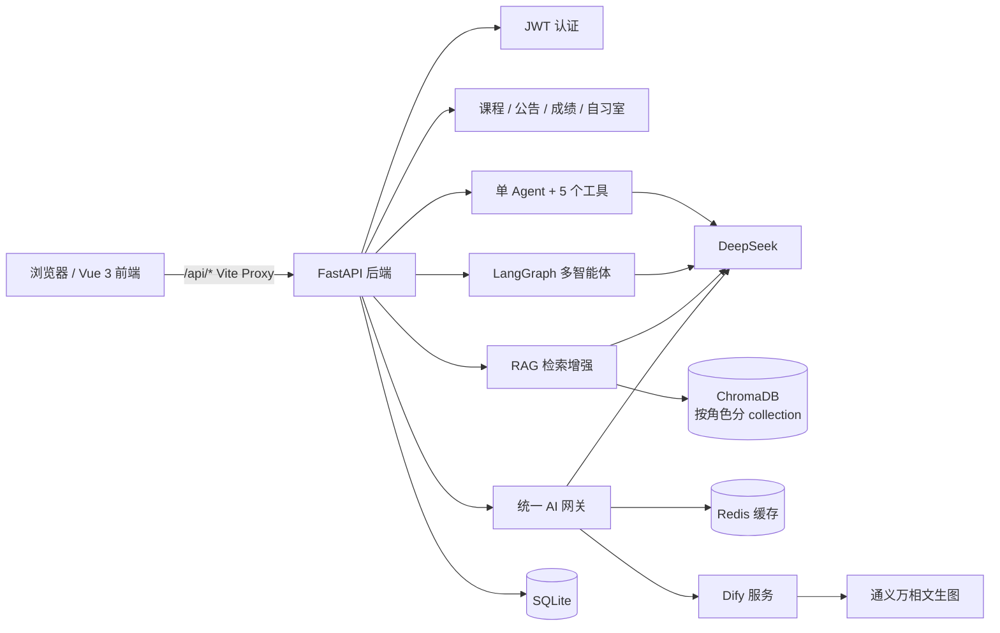

# 校园AI助手平台

面向校园场景的 AI 助手一体化平台：既能把课程、成绩、公告、自习室这类校园业务数据用自然语言查出来，也支持知识库问答（RAG）、工具调用型 Agent、多智能体协作流水线，并集成 Dify 提供流式对话、语音和文生图能力。

后端 FastAPI + SQLite，前端 Vue 3 + Vite，AI 侧基于 LangChain / LangGraph / ChromaDB / DeepSeek / Dify。

---

## 功能特性

| 模块         | 能力                                                                                                                                                                                                       |
| ------------ | ---------------------------------------------------------------------------------------------------------------------------------------------------------------------------------------------------------- |
| 多角色认证   | 注册 / 登录（JSON 与 OAuth2 表单两种），JWT 鉴权；角色分 `student`、`teacher`、`admin`、`decision_maker`                                                                                                   |
| 校园业务     | 课程增删改查、公告增删改查、成绩查询、自习室状态查询                                                                                                                                                       |
| Agent 智能体 | Function Calling 直连数据库，内置 5 个工具：`query_course`、`query_grade`、`lookup_student`、`query_study_room`、`query_announcement`；按角色区分“查自己的成绩”还是“代查学生成绩”；支持 SSE 流式与会话记忆 |
| RAG 知识库   | 上传 PDF / DOCX / DOC / TXT（≤20MB），500 字切分、50 重叠入 Chroma；**按角色隔离 collection**（`campus_knowledge_<role>`），避免不同角色看到彼此的知识库；检索 + 流式生成                                  |
| 多智能体协作 | LangGraph `StateGraph` 四节点流水线：分类 → 检索 → 回复 → 质检，SSE 分阶段推送（`classified` / `retrieved` / `delta` / `done`）并返回质量分                                                                |
| Dify 集成    | Agent 对话代理（流式）、工作流运行与状态轮询、TTS 长文本智能分段、STT 热词管理、通义万相文生图                                                                                                             |
| 统一 AI 网关 | 按 `service_type`（`langchain` / `langgraph` / `dify`）分发，命中 Redis 缓存可跳过重复 LLM 调用；Redis 不可用时自动降级                                                                                    |
| 对话历史     | 按 `session_id` 聚合会话列表、查看明细、删除、写入                                                                                                                                                         |

---

## 技术栈

**前端**：Vue 3.5、Vite 8、Pinia、Vue Router 4、Axios
**后端**：FastAPI 0.115、Uvicorn、SQLAlchemy 2.0、Pydantic v2、SQLite
**AI**：LangChain 0.3、LangGraph、ChromaDB 0.5、Sentence-Transformers / ONNX Runtime、DeepSeek（OpenAI 兼容协议）、Dify、通义万相（DashScope）
**基础设施**：Redis（可选缓存）、JWT（python-jose + passlib/bcrypt）

---

## 架构



---

## 目录结构

```
.
├── backend/
│   ├── app/                  # 核心业务
│   │   ├── api/              # auth / courses / announcements / chat / langchain_chat
│   │   ├── core/             # 配置、数据库、安全、依赖注入
│   │   ├── models/           # user / course / grade / announcement / study_room / chat
│   │   └── schemas/
│   ├── agent/                # 单 Agent：工具定义、会话图
│   ├── agent_multi/          # 多智能体：classifier / retriever / responder / quality
│   ├── rag/                  # 加载 → 切分 → 向量库 → 检索
│   ├── lc/                   # LangChain 封装：模型、链、记忆、提示词
│   ├── routers/              # agent / agent_multi / rag / knowledge / dify / history / ai 网关
│   ├── services/             # Redis 缓存、TTS 分段、STT 热词、文生图
│   ├── knowledge_docs/       # 预置知识库文档（数据库原理、Python 基础）
│   ├── prompts/              # 提示词模板
│   ├── main.py               # FastAPI 入口
│   ├── requirements.txt
│   └── .env.example          # 环境变量模板
├── frontend/
│   └── src/
│       ├── api/              # 按模块封装的请求
│       ├── views/            # Login / Register / Dashboard / Chat / Knowledge / Agent / Dify
│       ├── components/       # 聊天输入、消息列表、语音输入、语音播放
│       ├── stores/           # Pinia
│       ├── router/
│       └── utils/axios.js    # 拦截器：注入 Token、401 跳转、错误统一处理
└── .gitignore
```

---

## 快速开始

### 环境要求

| 组件    | 版本                        | 必需                                 |
| ------- | --------------------------- | ------------------------------------ |
| Python  | 3.13（开发环境实测 3.13.3） | ✅                                   |
| Node.js | ≥ 20.19（Vite 8 要求）      | ✅                                   |
| Redis   | 任意版本                    | ⬜ 可选，不启动则缓存自动降级        |
| Dify    | 自建部署                    | ⬜ 可选，仅 `/api/dify` 相关功能需要 |

### 1. 启动后端

```bash
cd backend

# 创建虚拟环境
python -m venv venv
venv\Scripts\activate          # Windows
# source venv/bin/activate     # macOS / Linux

pip install -r requirements.txt
pip install langgraph scikit-learn   # requirements.txt 未收录这两个，agent_multi 与 rag 依赖

# 配置环境变量
copy .env.example .env         # Windows
# cp .env.example .env         # macOS / Linux
# 然后编辑 .env，填入自己的 API Key

python main.py
```

- 服务地址：<http://localhost:8000>
- 交互式接口文档：<http://localhost:8000/docs#>
- 健康检查：<http://localhost:8000/health>

首次启动会自动执行 `Base.metadata.create_all` 建表，数据库为 `backend/campus_ai.db`（SQLite，已在 `.gitignore` 中排除）。

### 2. 启动前端

```bash
cd frontend
npm install
npm run dev
```

访问 <http://localhost:5173>。前端 `baseURL` 为 `/api`，已通过 `vite.config.js` 的 proxy 转发到 `http://localhost:8000`，无需改代码。

### 3. 配置 Dify（可选）

本项目**不包含 Dify 源码**，需要自行部署一个 Dify 实例：

1. 按 [Dify 官方文档](https://docs.dify.ai/) 用 Docker Compose 部署；
2. 在 Dify 里创建 Agent 应用（和历史库/工作流），拿到应用 API Key；
3. 在 `backend/.env` 中填写：

```ini
DIFY_API_BASE=http://localhost:8080/v1
DIFY_API_KEY=app-xxxxxxxx
DIFY_AGENT_APP_ID=xxxxxxxx-xxxx-xxxx
DIFY_WORKFLOW_APP_ID=xxxxxxxx-xxxx-xxxx
```

> `DIFY_API_BASE` 必须直接停在 `/v1` 这一层，因为代码会自行拼接 `/chat-messages`、`/workflows/run`。

---

## 环境变量

复制 `backend/.env.example` 为 `backend/.env` 后按需修改（`.env` 不会提交到仓库）：

| 变量                                                        | 默认值                                      | 说明                                         |
| ----------------------------------------------------------- | ------------------------------------------- | -------------------------------------------- |
| `DATABASE_URL`                                              | `sqlite:///./campus_ai.db`                  | 数据库连接串，可换成 MySQL / PostgreSQL      |
| `SECRET_KEY`                                                | `campus-ai-secret-key-change-in-production` | JWT 签名密钥，**部署前必须更换**             |
| `ACCESS_TOKEN_EXPIRE_HOURS`                                 | `8`                                         | Token 有效期（小时）                         |
| `REDIS_HOST` / `REDIS_PORT` / `REDIS_DB` / `REDIS_PASSWORD` | `localhost` / `6379` / `1` / `difyai123456` | 可选缓存，连接失败自动跳过                   |
| `DEEPSEEK_API_KEY`                                          | 空                                          | 对话模型 Key，**Agent / RAG / 网关都依赖它** |
| `DEEPSEEK_API_BASE`                                         | `https://api.deepseek.com/v1`               | OpenAI 兼容协议地址                          |
| `QWEN_API_KEY`                                              | 空                                          | 通义万相文生图 Key                           |
| `DIFY_API_BASE`                                             | `http://localhost:8080/v1`                  | Dify 服务 API 根地址                         |
| `DIFY_API_KEY`                                              | 空                                          | Dify 应用 Key，未配置时 `/api/dify` 返回 500 |
| `DIFY_AGENT_APP_ID` / `DIFY_WORKFLOW_APP_ID`                | 空                                          | Agent 应用 / 工作流应用 ID                   |
| `CORS_ORIGINS`                                              | `["*"]`                                     | 跨域白名单，生产建议收敛                     |

---

## 首次使用：创建账号

仓库不包含数据库文件，首次启动后**没有任何账号**，需要先注册。注册接口的 `role` 支持 `student` / `teacher` / `admin` / `decision_maker`，创建管理员时传 `admin` 即可：

```bash
curl -X POST http://localhost:8000/api/auth/register \
  -H "Content-Type: application/json" \
  -d "{\"username\":\"admin\",\"email\":\"admin@example.com\",\"password\":\"你的密码\",\"full_name\":\"管理员\",\"role\":\"admin\"}"
```

也可以直接在 <http://localhost:8000/docs> 里调用 `POST /api/auth/register`。返回体中的 `access_token` 也可用于调试其他接口（`Authorization: Bearer <token>`）。

登录后可在 `Dashboard` 页按角色看到不同入口：管理员看到课程 / 公告 / 用户总数，学生看到功能卡片。

---

## 主要接口

| 模块     | 方法 & 路径                                                                                   | 说明                                        |
| -------- | --------------------------------------------------------------------------------------------- | ------------------------------------------- |
| 认证     | `POST /api/auth/register` / `login` / `token`                                                 | 注册 / JSON 登录 / OAuth2 表单登录          |
|          | `GET /api/auth/me`、`GET /api/auth/users`                                                     | 当前用户信息、用户列表（管理员）            |
| 课程     | `GET/POST /api/courses`、`GET/PUT/DELETE /api/courses/{id}`                                   | 课程 CRUD                                   |
| 公告     | `GET/POST /api/announcements`、`GET/PUT/DELETE /api/announcements/{id}`                       | 公告 CRUD                                   |
| 对话     | `POST /api/chat/send`、`GET /api/chat/templates`                                              | 基础对话与提示词模板                        |
| Agent    | `POST /api/agent/chat`                                                                        | 工具调用型智能体，`stream=true` 走 SSE      |
| 多智能体 | `POST /api/agent/multi/chat`                                                                  | 分类→检索→回复→质检流水线，SSE 推送阶段事件 |
| 知识库   | `POST /api/knowledge/upload`、`GET /api/knowledge/info`                                       | 上传文档、查看当前角色知识库统计            |
|          | `DELETE /api/knowledge/reset`、`DELETE /api/knowledge/documents/{file_id}`                    | 清空 / 删除单篇                             |
| RAG      | `POST /api/rag/query`、`GET /api/rag/search`                                                  | 问答（可流式）、仅检索                      |
| Dify     | `POST /api/dify/agent/chat`、`/agent/chat/stream`                                             | 对话代理                                    |
|          | `POST /api/dify/workflow/run`、`GET /api/dify/workflow/status/{task_id}`                      | 工作流运行与轮询                            |
|          | `POST /api/dify/tts/segment`、`GET /api/dify/tts/styles`                                      | 长文本分段、音色列表                        |
|          | `GET/POST /api/dify/stt/hotwords`、`GET /api/dify/stt/categories`                             | 语音识别热词                                |
|          | `POST /api/dify/image/generate`、`GET /api/dify/image/templates`                              | 文生图与场景模板                            |
| 历史     | `GET /api/history/sessions`、`GET/DELETE /api/history/session/{id}`、`POST /api/history/save` | 会话列表、明细、删除、写入                  |
| 网关     | `POST /api/ai/chat`、`POST /api/ai/chat/stream`、`GET /api/ai/health`                         | 统一入口 + 缓存                             |

除 `/`、`/hello`、`/health`、注册登录外，所有接口都需要 `Authorization: Bearer <access_token>`。

---

## 常见问题

**`ModuleNotFoundError: langgraph` / `sklearn`**
`requirements.txt` 里没有收录这两个包，装完依赖后补一条 `pip install langgraph scikit-learn`。

**`/api/dify` 返回 500 且提示 `DIFY_API_KEY not configured`**
`backend/.env` 里没有填 `DIFY_API_KEY`，或 Dify 服务没起来。

**RAG 问答返回 `Knowledge base is empty`**
当前角色的 Chroma collection 里还没有文档。先调 `POST /api/knowledge/upload` 上传，注意知识库**按角色隔离**——学生上传的文档只有学生能检索到。

**前端提示“网络错误：后端未启动”**
后端没跑或端口不是 8000，前端 `vite.config.js` 的 proxy 目标需要同步修改。

**Redis 没启动会不会报错**
不会。`services/cache.py` 里所有 Redis 操作都包了 `try/except`，连不上就跳过缓存。

**需要下载 embedding 模型吗**
不需要。`rag/embeddings.py` 用的是 `sklearn` 的 `HashingVectorizer`（256 维、L2 归一化），纯本地计算，无外网依赖。仓库里被忽略的 `onnx_models/` 只是本地实验遗留，不参与运行。

---

## 说明与限制

- 嵌入向量采用哈希特征而非语义模型，检索靠字面重合度，属于教学演示级别的 RAG，不适合对召回质量要求高的场景。
- SQLite 单文件数据库，默认未做并发优化，多用户高并发场景建议换 PostgreSQL/MySQL。
- Dify 源码、虚拟环境、`node_modules`、数据库文件、`.env` 均不在仓库中，见 `.gitignore`。
- 默认 `SECRET_KEY` 和演示账号仅用于本地，任何对外部署都必须更换密钥与密码。

## 致谢

基于 [FastAPI](https://fastapi.tiangolo.com/)、[Vue](https://vuejs.org/)、[LangChain](https://python.langchain.com/)、[LangGraph](https://langchain-ai.github.io/langgraph/)、[ChromaDB](https://www.trychroma.com/)、[Dify](https://dify.ai/) 构建。

本项目暂未附带 LICENSE 文件，如需开源请自行补充。
